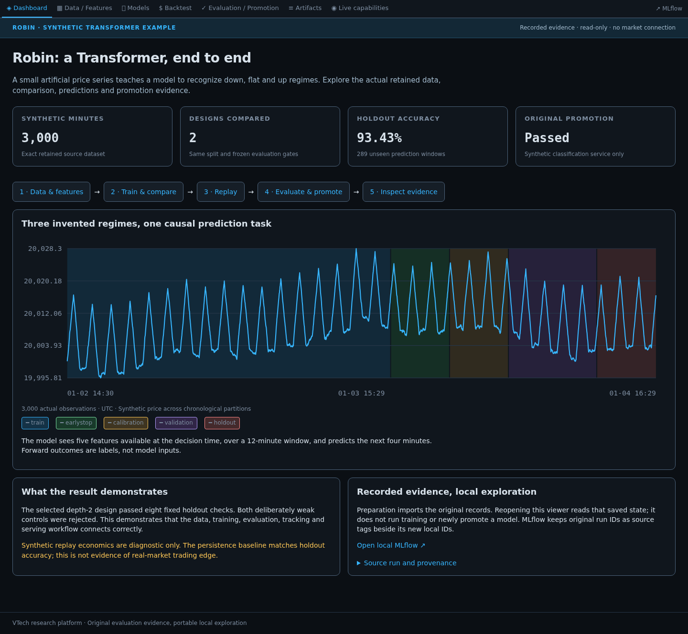

# X — ML Research Platform

A source showcase of the VTech quantitative research platform: market-data
acquisition, causal feature engineering, configurable model experiments,
walk-forward validation, execution-aware economics, and an operational WebUI.

**This is research infrastructure, not a proven profitable trading system.**
No vendor market data, private trading models, credentials, or operating database
is distributed. A small synthetic Transformer and its recorded test evidence are included. Historical research paths have known limitations; see
[capabilities and limitations](docs/PUBLIC_SHOWCASE.md) and
[the configuration audit](docs/CONFIG_AUDIT.md).

## Explore Robin: the Transformer workflow

**Robin** is a small, synthetic example: 3,000 minutes of invented prices and
five trailing features. It learned to classify the next four minutes as down,
flat, or up. Two Transformer designs were compared; the winner passed fixed
validation and holdout gates and was promoted for this synthetic service only.
This is not evidence of a real-market trading edge.

Use **Python 3.12 on Linux** (validated on OCI ARM64). This viewer needs no GPU,
PostgreSQL service, vendor credentials, cloud account, or training step. MLflow
uses its own local SQLite file. Start with a fresh environment; this profile
uses different dependency pins from the lightweight demo below.

```bash
git clone https://github.com/vbasin/X.git
cd X
python3.12 -m venv .venv
source .venv/bin/activate
python -m pip install -r requirements-showcase.lock
python -m pip install -e .
python -m src.showcase prepare --output .demo-output/robin
python -m src.showcase serve --output .demo-output/robin
```

Open **http://127.0.0.1:8700** for the WebUI and **http://127.0.0.1:5000** for
MLflow. Ctrl+C stops both. If a port is occupied, add `--port 8701 --mlflow-port
5001` to `serve`. To reopen, run only `serve`; `prepare` requires a new output
name. When running on a VM, forward both ports through SSH or your editor.

```text
Data / Features → Models → Backtest → Evaluation / Promotion → MLflow
   3,000 rows     2 designs  saved trades   fixed gates          run lineage
```



Explore the feature and split selectors, switch model designs, and inspect
predictions, the costed synthetic trade ledger, rejected controls and promotion
evidence. The artifact browser exposes the exact files used for the example.
Order books, live feeds and operational jobs are unavailable because this
fixture contains no such data.

The immutable fixture is under `examples/transformer-regime/`. Preparation copies
it into canonical `research/runs/` paths beneath `.demo-output/robin/` and imports
MLflow records with **new local IDs and original IDs retained as provenance**.
The UI labels these as recorded evidence; opening the example does not rerun or
re-promote the model. Runtime files stay out of Git.

For an **actual CPU training and promotion test**, install the optional profile
and run the frozen objective into a fresh output directory:

```bash
python -m pip install -r requirements-transformer.lock
python -m src.experiment.transformer_workflow \
  --objective config/workflows/synthetic_regime_objective.json \
  --data-root "$PWD/.demo-output/robin-rerun"
```

The supervisor caps the test at **15 minutes**, including training and serving
checks. A timeout is a failed test. No gates are relaxed to fit the time limit.
See the [complete walkthrough](docs/examples/TRANSFORMER_WORKFLOW.md) for viewing
your new run, model design, storage, MLflow lineage, and scoped verification.

## Run the lightweight offline demonstration

Python 3.10+; Python 3.12 is the release-validation target. No GPU, database,
Databento key, LLM key, cloud account, or environment file is needed.

```bash
git clone https://github.com/vbasin/X.git
cd X
python -m venv .venv
source .venv/bin/activate
python -m pip install -r requirements-demo.lock  # Tested Python 3.12 dependency set
python -m pip install -e ".[dev]"
vtech-demo --output .demo-output/first-run
make test-publication
```

Open `.demo-output/first-run/report.html` in a browser. Each invocation requires
a new output directory; existing outputs are never overwritten.

The example composes **real platform modules**:

1. Generate reproducible synthetic prices and causal trailing features.
2. Join context with the shared strict as-of primitive.
3. Build five expanding calendar folds with a one-minute purge.
4. Train the existing logistic-regression plugin's estimator using per-fold scaling.
5. Validate and persist canonical out-of-fold predictions.
6. Price illustrative one-minute trades using executable synthetic bid/ask,
   explicit adverse slippage, and one round-trip commission.
7. Persist the shared experiment manifest, input hash, fold metrics, model
   specification, trade ledger, economics, and an offline HTML report.

**All results are synthetic.** Accuracy and dollar figures demonstrate plumbing,
not a trading edge. No checkpoint is exported, no model is promoted, and no
broker connection or order submission occurs. The report is a standalone offline
walkthrough, not a mock claiming to be the full operating console.

## Platform source map

| Area | Source |
|---|---|
| Acquisition and ingestion | `src/acquisition/`, `src/ingestion/` |
| Shared storage, causality, code identity, compute | `src/common/` |
| Features, outcomes, training, model plugins | `src/features/`, `src/training/`, `src/models/` |
| Experiment identity and validation | `src/experiment/`, `src/validation/` |
| Search, replay, economic evaluation | `src/search/`, `src/backtest/`, `src/evaluation/` |
| Serving, paper simulation, execution integration | `src/serving/`, `src/paper/`, `src/execution/` |
| Optional cloud execution | `src/gpu_runner/` |
| Optional research automation | `src/agentic/`, `src/scoping/`, `src/research_director/` |
| Operational console and rule models | `src/webui/`, `src/external_models/` |

The [architecture](docs/ARCHITECTURE.md) distinguishes implemented components,
experimental research, and incomplete lifecycle wiring. Not every implementation
uses the same economic or validation path.

## Optional integrations

Install only what you intend to configure:

```bash
python -m pip install -e ".[platform,training,serving,agents]"
# Add .[deep-learning] separately for TensorFlow model families.
```

The full console is `python -m src.webui.app --host 127.0.0.1 --port 8700`,
but its useful data-backed pages require your own PostgreSQL/TimescaleDB schema,
authorized data, and local configuration. It is a local operator console, **not
a public Internet service**. Do not expose it as a hosted demo.

Historical service units, deployment recipes, and operator Makefile targets
retain deployment assumptions and are not turnkey public setup instructions.
Cloud/LLM/vendor integrations can incur charges. Paper/execution integration is
not enabled by the offline demo. The complete platform currently requires the
source checkout; the installed wheel supports the synthetic demo independently.

## Documentation

- [Transformer showcase and real rerun](docs/examples/TRANSFORMER_WORKFLOW.md)
- [Public scope, setup boundaries, and known limitations](docs/PUBLIC_SHOWCASE.md)
- [Architecture](docs/ARCHITECTURE.md)
- [Experiment artifacts](docs/EXPERIMENTS.md)
- [Causality and data contracts](docs/DATA_CONTRACTS.md)
- [Publication disposition](docs/PUBLICATION_SCOPE.md)
- [Third-party notices](THIRD_PARTY_NOTICES.md)

## Copyright and reuse

No open-source license is granted for the platform's original source.
Copyright remains with the respective copyright holders; public visibility does
not grant general reuse or redistribution permission beyond applicable law and
GitHub's terms. Third-party components retain their own licenses and notices.
