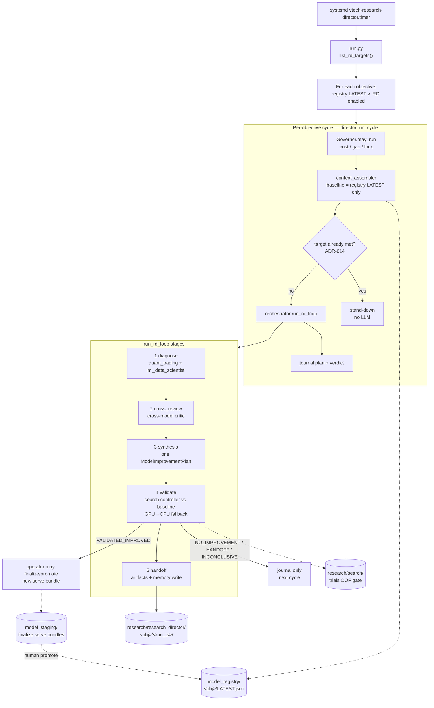
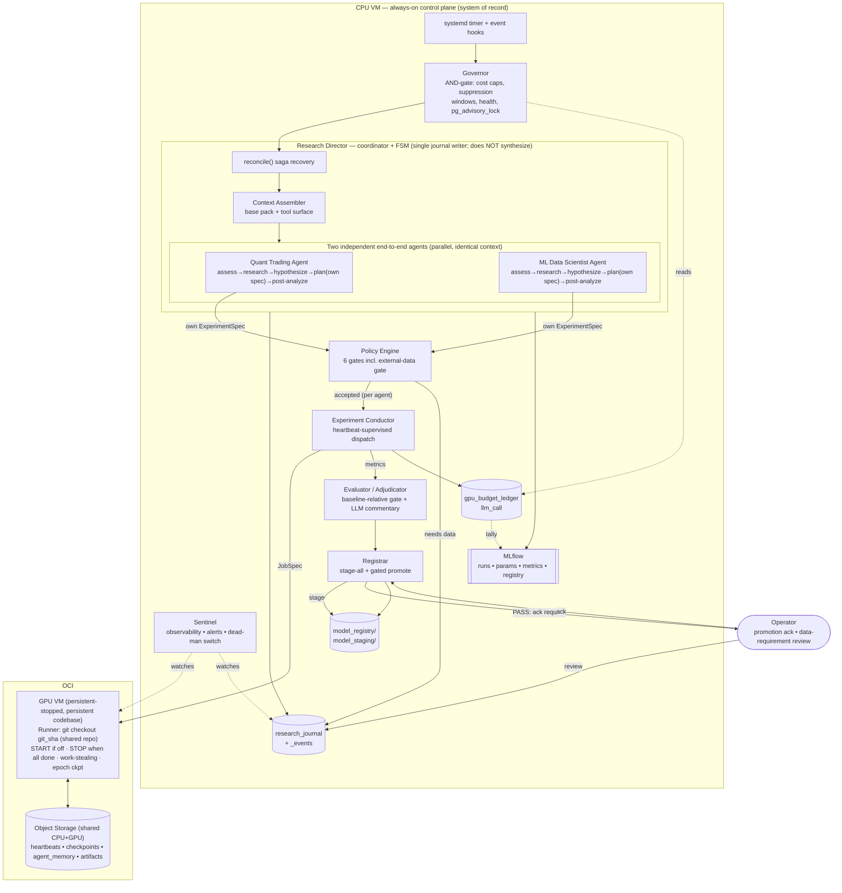

# Research Director — Automated ML Research Architecture

> **Present (as-built, 2026-08-12):** Scoping-style **orchestrator** in `src/research_director/orchestrator.py`:
> diagnose (quant_trading + ml_data_scientist) → cross_review → **synthesis** (one ranked
> `ModelImprovementPlan`) → auto-validate → handoff. Timer
> `vtech-research-director.timer` is **disabled** (operator-stopped 2026-08-12; re-enable after
> validation quality is acceptable). One cycle per **RD-enabled** objective with registry
> `LATEST`. Schema `config/schemas/model_improvement_plan.schema.json` (features oneOf).
> Auto-validate sanitizes `executable_candidate.features` before `manual_candidates` load.
> LLM `model_rates` live in `config/runtime/research_director.yaml` (Opus 4.8 + GPT-5.6 Terra).
> **Supersedes in code:** deleted Phase-19/20 modules (`agent.py`, `conductor.py`,
> `policy_engine.py`, `experiment_spec.schema.json`, etc.) — do not treat sections below that
> still describe those names as current without cross-checking the tree.  
> **Next:** multi-family search (P4); optional ADR to freeze synthesizer vs dual-independent
> topology; re-enable timer when operator approves.  
> **Related ADRs**: [ADR-012](../decisions/ADR-012-gated-promotion-mlflow-lineage.md),
> [ADR-013](../decisions/ADR-013-two-expert-panel.md), [ADR-025](../decisions/ADR-025-scoping-v2-agentic-research-loop.md).

---

## 0. As-built module map (authoritative for “what runs”)

| Module | Role |
|--------|------|
| `orchestrator.py` | 5-stage loop; writes `research/research_director/<objective>/<run_ts>/`; normalizes features before validate |
| `director.py` | Governor → assemble → stand-down → orchestrator → journal |
| `run.py` | Entry: for each RD-enabled objective with registry LATEST → one cycle |
| `rd_enable.py` | Per-objective enable flags (`ops/webui/rd_objectives.json`) |
| `context_assembler.py` | Context pack (registry LATEST baseline + KPIs + patterns) |
| `governor.py` / `cost.py` / `journal.py` / `evaluator.py` | Control plane gates (`journal` needs `data_requirement` JSONB) |
| `registry.py` / `tools.py` / `skills/` | In-process tools + playbooks |
| `rag_memory.py` / `memory.py` | Per-agent memory (embeddings need OpenAI credit if backend=openai) |
| `sentinel.py` / `mlflow_tracking.py` | Observability / lineage helpers (MLflow optional; fails open) |

### 0.1 As-built cycle (mermaid)

**This is the living chart.** Mermaid diagrams in §3 / later sections describe the
*historical* dual-agent / conductor design — ignore them for current behaviour.



Sections §1+ retain historical design prose (two independent end-to-end agents, policy engine,
experiment conductor). Prefer **§0 + source** when they disagree.

---

## 1. Purpose & Scope

The Research Director is an automated, objective-driven **model-improvement** loop (not Stage-0
scoping). On a schedule it should: (1) assemble program + model state, (2) run two field-expert
lenses over the same context, (3) produce a validated improvement plan, (4) train/score the top
change against the baseline via the search stack, (5) journal + MLflow lineage, (6) hand off
data/code needs without auto-downloading paid data.

**As-built deviation from ADR-013:** the loop **synthesizes one ranked plan** rather than running
two fully independent ExperimentSpecs with no merge. See header **Next** for topology freeze.

**Control-plane / execution-plane split** (unchanged from the current build): the always-on
CPU VM is the orchestrator and system of record; a persistent-stopped OCI GPU VM is the
ephemeral execution plane started only when work is queued and stopped as soon as all
post-run side-effects flush. **LLM agents propose; deterministic policy code disposes** —
no agent has authority over billing, infrastructure, or the model registry.

The objective is supplied at runtime from [config.yaml](../../config.yaml)
(`program objectives`, `success thresholds`, `labels`). The example objective —
"detect intraday ±50-point NQ momentum moves with minimal MAE" — is illustrative; the loop
is objective-agnostic.

---

## 2. Non-Negotiable Principles

| # | Principle | How the architecture satisfies it |
|---|-----------|-----------------------------------|
| P1 | Iterative objective-driven loop | `Governor → Director.run_cycle() → reconcile → assess → plan → execute → evaluate → stage → journal`, re-reading the objective + latest model each cycle |
| P2 | Two independent expert agents | `quant_trading` + `ml_data_scientist` run concurrently with identical full context; **each owns a complete, independent end-to-end workflow** (assess → research → hypothesize → plan → execute → evaluate → post-analyze → journal). **No merge, clustering, or corroboration** — the Director only coordinates, it does not synthesize |
| P3 | External-data guardrail | `EXTERNAL_DATA_REQUIRED` journal state + `data_requirement` artifact; Policy Engine Gate 6 routes data-dependent specs to journal-only and the agent proceeds to the next no-download experiment |
| P4 | Context inputs | `context_assembler` builds a base pack (objectives, latest-model artifacts + feature schema, dataset/parquet inventory, DB table inventory + schemas + row counts, architecture docs + ADRs + external-research docs, journal, memory recall) **plus a tool surface** so each agent pulls deeper context just-in-time (§4.4) |
| P5 | LLM cost governance | `llm_call` + `gpu_budget_ledger` ledgers; per-iteration USD cap with **warn → degrade → halt**; running tally surfaced via MLflow metric + funnel view |
| P6 | MLflow integration | research iteration → MLflow **parent run**; each GPU training run → **child run**; cost + verdict metrics + journals/plans as artifacts; registry staging mirrored to MLflow Model Registry stages |

---

## 3. Component Architecture



The component set is unchanged in spirit from the current control/execution split; the
**redesign deltas** are: replace the four finding-mining lenses with **two independent
end-to-end agentic workflows** that each plan their own experiment (§4) — the Director no
longer merges or synthesizes; add the external-data gate as Policy Engine **Gate 6** (§6);
make MLflow the lineage spine (§7); and make cost governance a live warn→degrade→halt
controller (§8).

### 3.1 GPU execution plane (persistent codebase + shared storage)

> **Updated by [ADR-022](../decisions/ADR-022-oci-queue-code-bundle-autonomous-gpu.md) (2026-07-10):**
> the queue is now the managed **OCI Queue** (jobs + results channels), code identity is a
> **content-addressed bundle** (tar→zstd→sha256, not `git checkout`), and lifecycle is an
> **autonomous self-shutting-down worker** + idempotent `GpuProvider.ensure_running` (START iff
> STOPPED) — the CPU never issues STOP. The persistent-stopped VM + shared Object Storage below
> still hold; the git-sync and CPU-STOP details are superseded.

The GPU VM is a **persistent-stopped** OCI instance (started/stopped, **never terminated**)
whose **boot volume keeps the codebase between runs** — it is not re-imaged each launch.
Code, storage, and lifecycle are wired as follows:

- **Code sync via the shared GitHub repo.** Both VMs clone the same repository. At job start
  the GPU Runner runs `git fetch && git checkout <git_sha>` to the spec's pinned commit, so
  it always executes the exact reproducible code **without re-baking an image**. Only
  dependency changes (`requirements.lock`) require a one-time manual re-provision.
- **Enforced code-identity contract** ([ADR-016](../decisions/ADR-016-gpu-job-code-identity-contract.md)).
  The above sync is guarded on both sides: the **producer** (`controller._git_sha(strict=True)`)
  refuses to dispatch unless the tracked tree is clean *and* the sha is on an `origin` branch
  (closing the "committed but not pushed" gap); the **consumer** pins with
  `git fetch origin <sha> && git checkout --detach <sha>` **before importing any job code**;
  and the runner echoes `ran_sha` back in the done marker so the collector flags any
  requested-vs-ran divergence.
- **Shared OCI Object Storage.** The GPU VM reads/writes the **same** bucket as the CPU VM
  (`vtech_hot`) for heartbeats, per-epoch checkpoints, model artifacts, and agent memory —
  so nothing durable lives only on the GPU and a stop/start loses no state.
- **Lifecycle = START → run all → STOP (never TERMINATE).** The Conductor issues
  `GpuProvider.start()` only if the instance is not already RUNNING; the Runner drains
  **all** queued experiments (work-stealing, no idle gap); `GpuProvider.stop()` fires **only
  after every experiment completes and all artifacts are flush-confirmed** (`DRAINING`
  state). `terminate_instance` is never called.
- **Cost safety = CPU-side reapers only (for now).** Lease-TTL, idle-util, and the Sentinel
  dead-man's-switch all run **from the CPU VM** (a hung GPU cannot keep itself alive). The
  instance-side **self-shutdown timer is intentionally omitted** in this design and tabled
  as a possible future backstop (see PHASE-20 roadmap, W9).

---

## 4. Two Independent End-to-End Expert Agents

The cognitive layer is **two autonomous agents that never merge**. Each runs a complete,
independent research workflow over the same context and emits **its own** experiment. The
Director *coordinates* (launches both, owns the journal, splits the per-cycle budget,
schedules GPU jobs) but performs **no synthesis, clustering, corroboration, or conflict
resolution**. If both agents produce a viable experiment in a cycle, **both** are validated,
queued, run, evaluated, and journaled independently (budget permitting).

### 4.1 Roles

| Agent | Lens | Owns end-to-end |
|-------|------|-----------------|
| **Quantitative Trading Agent** (`quant_trading`) | Alpha, tradeability, market structure, label economics, regime dependence, signal usability at τ | yes |
| **ML Data Scientist Agent** (`ml_data_scientist`) | Architecture fit, training procedure, label learnability, calibration, fold variance, **+ data-quality / leakage / reproducibility checklist** (folded in from the retired systems-architect & data-engineer lenses) | yes |

### 4.2 Per-agent end-to-end workflow

Each agent, independently and in parallel, executes the full loop every cycle:

1. **Assess** the latest model against the program objective using the Context Pack
   (training results, feature attribution, fold variance, confusion matrix, journal of
   prior outcomes — so it never re-proposes a `DISPROVEN` idea).
2. **Research** — gather the evidence needed for an optimal experiment: internal corpus
   first (`research_cases/papers/`, `docs/decisions/`, architecture docs), then external
   literature/web **read-only** search when internal evidence is insufficient. (External
   *data downloads* remain forbidden — see §6; reading research is not downloading data.)
3. **Hypothesize** — form one falsifiable hypothesis with an expected effect size on the
   primary metric, citing evidence anchors (confabulation guard).
4. **Plan its own experiment** — the Hypothesis Planner is *inside* each agent: it converts
   the hypothesis into a complete `ExperimentSpec`
   ([experiment_spec.schema.json](../../config/experiment_spec.schema.json)) —
   `CONFIG_DIFF` or `NEW_COMPONENT`, with `metric`, `delta_min`, `folds`, `seed`,
   `est_cost_usd`, and the external-data fields (§6). The agent applies its own domain
   understanding to decide *what* to change and *how* to test it.
5. **Self-critique / reflect** (evaluator-optimizer pass) — the agent red-teams its own
   spec against a rubric (objective-fit, cost, reproducibility, locked-sections) and
   revises once before submitting. A cheap quality gate that mirrors the `agentic-eval` skill.
6. **Validate** — submit the spec to the deterministic **Policy Engine** (6 gates). The
   agent retries once on rejection with the reason injected; second failure defers the idea.
7. **Execute** — the validated spec is handed to the Conductor → GPU Runner (shared infra).
8. **Post-analyze** — when results return, the *same* agent interprets them vs the objective
   and the baseline, decides `SUCCEEDED` / `DISPROVEN` / `NEEDS_REFINEMENT(tweaks[])`
   (bounded by the deterministic Evaluator verdict), and writes the conclusion.
9. **Journal** — every step is written to the agent's own journal thread and its vector
   memory, so it improves cycle-over-cycle.

> **Independence guarantee:** the two agents share only read-only context and the
> deterministic infrastructure (Policy Engine, Conductor/GPU, Evaluator, Registrar,
> journal, ledgers). They do **not** see each other's findings, specs, or conclusions in a
> cycle. Resource contention is resolved deterministically by the Director (FIFO GPU queue,
> per-agent budget slice), never by reconciling their *ideas*.

### 4.3 Agentic harness (latest-practice)

Each agent is a **tool-using agentic loop** (plan → act → observe → reflect), not a
single-shot prompt. Harness components:

- **Tool registry** (typed, deterministic, side-effect-bounded): context readers (registry
  artifacts, journal, feature catalog), a **DB/data inventory inspector** (table list,
  schemas, row counts), a **dataset/parquet catalog reader** (snapshot coverage, row
  counts), a **research/literature search** tool (internal-first, external read-only behind
  a flag), attribution readers (`integrated_gradients`, `permutation_importance`, `shap`),
  and memory recall/write.
- **Skills** — reusable parameterized procedures the agent can invoke (e.g. *design a
  walk-forward experiment*, *propose a feature-group ablation*, *audit calibration at τ*),
  aligned with the repo's skills system.
- **Just-in-time context** — the base Context Pack is kept lean; the agent pulls deeper
  detail through tools on demand (context-engineering best practice; controls token cost).
- **Bounded loop + per-agent budget** — hard caps on passes/tool-calls and a per-agent
  slice of the cycle LLM budget (§8), so each agent terminates and stays in budget.
- **Effort scaling** — the prompt embeds heuristics that scale tool-call effort to task
  complexity (cheap idea → few calls; architecture change → deeper research), preventing
  over-spend on simple ideas (Anthropic multi-agent finding: token usage explains ~80% of
  performance variance).
- **In-process typed tool registry (no MCP).** Because every tool, skill, and agent lives in
  the same Python codebase (`src/research_director/`), tools are plain typed Python callables
  registered in a local registry — **no Model Context Protocol / cross-process server is
  needed**. The valuable part of the standard is kept: first-class agent-computer interface
  (ACI) discipline — strong docstrings/JSON schemas, poka-yoke args, absolute paths, worked
  examples. (MCP is tabled as a future option only if tools are ever exposed to external
  clients.)
- **Artifact-passing, not chat-passing** — agents persist findings/plans/results as
  artifacts (Object Storage + MLflow) and pass lightweight *references*, never large blobs
  through the coordinator (avoids the multi-agent “game of telephone”).
- **Structured outputs** — every hypothesis, spec, and conclusion is schema-validated.

> **Current-state assessment (to optimize):** today's `config/agents/quant_trading.md` and
> `ml_data_scientist.md` are **finding-miners** ("propose *directions*, not config_diffs;
> the Planner formalizes them"; "one of four independent experts"). To meet this design they
> must be rewritten as **end-to-end agent definitions** that own hypothesize→plan→execute→
> post-analyze, declare their tool/skill access, and follow the research-then-decide loop.
> `experts.py` must become an agentic runner (tool dispatch + reflection), `planner.py`
> logic moves *inside* each agent, and `tools.py` must gain the DB-inventory,
> dataset-catalog, and (gated) external-research tools.

### 4.4 Context surface (full scope — P4)

Assembled fresh each cycle and handed **identically** to both agents (base pack), with the
rest reachable via tools:

| Category | Contents | Source |
|----------|----------|--------|
| **Program objectives** | objective string, success thresholds, label config (`big_move_threshold`, `mae_tolerance`) | `config.yaml` |
| **Latest-model context** | `config_snapshot.json`, **feature schema** (`features.json`), `training_result.json` (metrics, history, confusion matrix, `precision_at_tau`, `feature_group_importance`, `integrated_gradients`), `provenance.json`, datasets + `snapshot_id` + date range + row counts used | `model_registry/…/LATEST_STABLE` |
| **Data inventory** | DB table list + schemas + row counts (`databento.*`), parquet/snapshot catalog (`CATALOG.json`, `LATEST.json`, date coverage), enabled feature groups | DB + `data/features/…`, `config.yaml` |
| **Codebase/docs** | architecture docs (SYSTEM, FEATURE_ENGINE, ML_MODEL, DATA_PIPELINE, DATABASE_SCHEMA, this doc), ADRs, **external research docs** (`research_cases/papers/`, `FINDINGS_SUMMARY.md`, coverage matrices), `FEATURE_CATALOG.md`, `BACKLOG.md` | `docs/`, `research_cases/` |
| **History** | recent journal entries + outcomes (incl. `DISPROVEN`), the agent's own prior experiments | `research_journal` |
| **Per-agent memory** | semantic recall of the agent's own prior findings/conclusions/outcomes | OCI Object Storage memory |

The current `context_assembler` supplies objectives + baseline + journal + feature catalog
+ backlog; the **inventory** (DB tables/schemas/row counts, dataset/snapshot catalog) and
**architecture/external-research docs** are the additions this redesign requires.

### 4.5 Agent & harness component inventory (build/redefine checklist)

Everything the two agents need for end-to-end functionality, with disposition and file
path. **All components live in the codebase — no external services, no MCP.**

| # | Component | Disposition | File / location | Responsibility |
|---|-----------|-------------|-----------------|----------------|
| C1 | **Agent definition** (persona) | Redefine | `config/agents/{quant_trading,ml_data_scientist}.md` | End-to-end system prompt: role/lens, the 9-step workflow (§4.2), tool/skill access, output contracts, effort-scaling heuristics, hard rules (evidence anchors, no data downloads) |
| C2 | **Agent runner / harness loop** | Redefine | `src/research_director/experts.py` (→ agentic runner) | The plan→act→observe→reflect loop: dispatch tools, manage bounded passes + per-agent budget, run the reflection pass, enforce structured outputs |
| C3 | **Tool registry** | Build | `src/research_director/tools.py` (+ registry) | In-process typed registry: tool name → callable + JSON schema + ACI docstring (no MCP) |
| C4 | **Context tools** | Extend | `tools.py` | `load_latest_stable`, `load_recent_journal`, `read_reference` (exist) + **DB-inventory inspector**, **dataset/parquet catalog reader**, **attribution reader**, **arch/external-research doc loaders** (new) |
| C5 | **Research tool** | Extend | `tools.py::ResearchTool` | Internal-corpus-first literature search; enable read-only external web search (NOT data download) |
| C6 | **Skills** | Build | `src/research_director/skills/` | Reusable parameterized procedures: *design walk-forward experiment*, *feature-group ablation*, *audit calibration@τ*, *estimate experiment cost* |
| C7 | **Context assembler** | Extend | `context_assembler.py` | Build the lean base pack (objectives + latest-model + inventory index); deep context served via C4 tools |
| C8 | **Per-agent Hypothesis Planner** | Redefine | folded into C2 (from `planner.py`) | Each agent converts its own hypothesis → `ExperimentSpec` |
| C9 | **Self-critique / reflection** | Build | C2 (optional `reflection.py`) | Evaluator-optimizer pass: score + revise the spec once before submission |
| C10 | **Output schemas** | Extend | `schemas.py`, `experiment_spec.schema.json` | `Finding` (exists), `ExperimentSpec` (+ external-data fields), new `AgentConclusion` (post-analysis), `data_requirement` |
| C11 | **Per-agent memory** | Reuse | `memory.py` | Semantic recall/write of the agent's own prior findings/conclusions/outcomes (OCI Object Storage) |
| C12 | **LLM client + cost metering** | Extend | `llm.py` | Chat/JSON/embeddings; per-agent budget slice + warn→degrade→halt; MLflow tracing hook |
| C13 | **Policy Engine** | Extend | `policy_engine.py` | 6 deterministic gates incl. external-data Gate 6 — the validation boundary every spec crosses |
| C14 | **Journaling hooks** | Build | `journal.py` (single writer) | Persist each agent's findings, spec, conclusion, and outcome as journal rows + events |
| C15 | **MLflow trace/eval hooks** | Build | C2 + `evaluator.py` | Trace the agent loop (spans); LLM-judge experiment-quality pre-gate (advisory) |

C1–C12 + C14–C15 are the **agent/harness** scope (rebuild workstreams W1–W3, W7); C13 is
the deterministic boundary; the deterministic execution/eval backend (Conductor, Evaluator,
Registrar, GPU plane) is covered in §3/§3.1 and the roadmap.

---

## 5. One Research Iteration (sequence)

```mermaid
sequenceDiagram
    autonumber
    participant T as systemd timer
    participant G as Governor
    participant D as Director (FSM)
    participant CA as Context Assembler
    participant QT as Quant Agent
    participant DS as ML DS Agent
    participant PE as Policy Engine
    participant L as Cost Ledger
    participant C as Conductor
    participant GPU as GPU Runner
    participant EV as Evaluator
    participant R as Registrar
    participant M as MLflow
    participant J as Journal
    participant H as Operator

    T->>G: fire
    G->>L: read GPU+LLM spend, activity, caps
    G->>G: AND-gate (caps, windows, health, advisory lock)
    alt gate fails
        G-->>J: log NO_OP (GPU never started)
    else gate passes
        G->>D: run_cycle()
        D->>J: reconcile() — recover stalled sagas, kill orphan GPU
        D->>M: start PARENT run (iteration N)
        D->>CA: assemble base Context Pack
        CA-->>D: objectives + model + inventory + docs (+ tool surface)
        par independent agents — NO merge, NO corroboration
            D->>QT: launch end-to-end workflow (own budget slice)
            QT->>QT: assess → research (tools) → hypothesize
            QT->>L: charge LLM tokens (warn→degrade→halt)
            QT->>QT: plan OWN spec → self-critique/reflect
            QT->>PE: validate(spec)
        and
            D->>DS: launch end-to-end workflow (own budget slice)
            DS->>DS: assess → research (tools) → hypothesize
            DS->>L: charge LLM tokens (warn→degrade→halt)
            DS->>DS: plan OWN spec → self-critique/reflect
            DS->>PE: validate(spec)
        end
        loop each accepted spec, independently (per owning agent)
            alt spec needs new external data
                PE-->>J: EXTERNAL_DATA_REQUIRED + data_requirement(vendor,fields,range,cost)
                PE-->>H: notify (review only — never auto-download)
            else accepted
                PE-->>D: SPEC_VALIDATED
                D->>C: dispatch
                C->>GPU: JobSpec(git_sha, config_diff, seed)
                C->>L: debit GPU instance-seconds
                GPU->>M: per-agent run — params + per-epoch metrics + artifacts
                GPU-->>C: heartbeats → COMPLETE (or OOM/NaN/lost)
                C->>EV: metrics + baseline
                EV->>EV: gate (Δ≥δ, guardrails, ≥2/3 folds, bootstrap CI)
                EV->>M: log verdict + metric deltas
                EV-->>QT: verdict (the owning agent post-analyzes)
                QT->>R: stage model (always) + provenance
                alt PASS
                    R->>H: promotion ack request
                    H-->>R: ack
                    R->>M: register → Staging/Production
                    R->>J: PROMOTED → SUCCEEDED_CLOSED
                else FAIL / INCONCLUSIVE
                    QT->>J: DISPROVEN_CLOSED or NEEDS_REFINEMENT(tweaks[])
                end
            end
        end
        D->>L: write iteration cost tally
        D->>M: log iteration cost + funnel metrics; end parent run
    end
```

---

## 6. External-Data Gate (P3)

External data is **never** downloaded by an agent (AGENTS.md §8). The gate is a *mechanism*,
not just a policy:

- **Spec field**: `ExperimentSpec` gains `requires_external_data: bool` and a
  `data_requirement` object `{vendor, dataset, fields[], date_range[start,end], est_cost_usd, rationale}`.
- **Policy Engine Gate 6** (`external_data_gate`): if `requires_external_data` is true, the
  spec is **rejected for execution** and the Director writes journal state
  `EXTERNAL_DATA_REQUIRED` carrying the `data_requirement`, notifies the operator, and
  proceeds to the **next-most-optimal cluster that needs no download**.
- The experiment is only revived after the operator confirms the data has been ingested
  (manual ack flips it back to `PROPOSED`). The loop never blocks waiting for data.

---

## 7. MLflow Integration (P6)

MLflow is the **experiment lineage spine**. Mapping:

| Research concept | MLflow object |
|------------------|---------------|
| One research iteration (cycle N) | **Parent run**, tagged `program_id`, `cycle` |
| Each **agent's** experiment | **Nested run** under the iteration, tagged `agent`, `experiment_id` |
| Each GPU training attempt (`run_id`) | **Child run** under the agent's run (`mlflow.parent_run_id`) |
| `config_diff` + spec fields | run **params** |
| Eval metrics (precision@τ, BU/BD F1, fold deltas) | run **metrics** |
| LLM + GPU cost, verdict, n_signals | parent-run **metrics** (`llm_usd`, `gpu_usd`, `iter_usd`) |
| Journals, plans, expert findings, diagrams, verdict commentary | run **artifacts** |
| Staged model | MLflow Model Registry **version** (stage `None`/`Staging`) |
| `LATEST_STABLE` promotion (on ack) | Registry stage transition → **`Production`** |

The `experiment_id ↔ mlflow_run_id` linkage is persisted in `research_journal` and mirrored
into `provenance.json` (already supported by [promote_model.py](../../scripts/promote_model.py)),
closing the lineage loop from objective → finding → spec → run → metrics → registry.

### 7.1 MLflow 3 agent-native features (adopt)

MLflow 3 is no longer just a training tracker — it is an **agent engineering platform**.
The repo currently pins `mlflow>=2.14` and uses only `start_run`/`log_params`/`log_metric`
in the trainer. The redesign upgrades to **MLflow 3.x** and adopts its agent-native modules:

| MLflow 3 module | Use in the Research Director |
|-----------------|------------------------------|
| **Tracing** (OpenTelemetry-compatible) | Trace each agent's full loop — every LLM call, tool call, retrieval, and reflection — as a span tree under the agent's run. This is the primary observability primitive for the non-deterministic agent layer (replaces ad-hoc logging). |
| **GenAI evaluation / LLM-as-judge** (`mlflow.genai.evaluate`, scorers) | A **pre-execution experiment-quality gate**: an LLM judge scores each proposed spec (hypothesis soundness, evidence-grounding, novelty vs journal) 0–1 + pass/fail, *complementing* the deterministic post-execution Evaluator (§ model-metric gate stays rule-based). |
| **Prompt Registry + optimization** | Version the agent personas/prompts (today flat `config/agents/*.md`); every experiment records which prompt version produced it; enables data-driven prompt optimization over cycles. |
| **AI Gateway** | Optional central LLM router for cost + model-access governance; complements the `llm_call`/ledger metering (§8) with a second, infra-level cost control point. |

> **Boundary preserved:** LLM-judge scores and traces are **advisory / observability** only.
> The promotion gate (Evaluator) and the money/infra gates (Policy Engine, Governor) remain
> deterministic — "LLM proposes, deterministic code disposes" is unchanged.

---

## 8. Cost Governance (P5)

Two independent ledgers in the `research_director` Postgres schema:

- **`llm_call`** — one row per LLM invocation (agent, model, tokens, USD, policy verdict).
- **`gpu_budget_ledger`** — rolling `(category, instance_id, seconds_active, usd_debited, ts)`;
  `category='llm'` rows mirror LLM spend, `category='gpu'` rows debited by the Conductor /
  Fleet reaper per billing interval.

**Per-iteration spend controller** (warn → degrade → halt):

| Band | Trigger | Action |
|------|---------|--------|
| **Warn** | `iter_spend ≥ warn_frac × cap` (default 0.75) | log P2 + surface tally; continue |
| **Degrade** | `iter_spend ≥ degrade_frac × cap` (default 0.9) | stop new LLM mining passes; finish only in-flight spec; skip optional round-2 cross-review |
| **Halt** | `iter_spend ≥ cap` | `CostCapExceeded` → panel aborts gracefully, GPU never started, iteration closes `NO_OP` with partial journal |

The cap is configured per iteration in [config/research_director.yaml](../../config/research_director.yaml)
(`cost.llm_usd_cap_cycle`) plus a new `cost.gpu_usd_cap_cycle`; per-model token rates move
from env (`RD_LLM_USD_PER_1K_IN/OUT`, currently defaulting to `0.0`) into a config
`cost.model_rates` map so spend is metered for real. The running tally is surfaced as an
MLflow parent-run metric and in the funnel view.

---

## 9. Experiment Journal — Lifecycle State Machine

```mermaid
stateDiagram-v2
    [*] --> PROPOSED
    PROPOSED --> PLANNED
    PLANNED --> SPEC_VALIDATED
    PLANNED --> EXTERNAL_DATA_REQUIRED: needs download
    EXTERNAL_DATA_REQUIRED --> PROPOSED: operator confirms data ingested
    SPEC_VALIDATED --> QUEUED --> RUNNING --> EVALUATING
    RUNNING --> FAILED_RUN: OOM/NaN/heartbeat-lost
    EVALUATING --> STAGED_PENDING_PROMOTION: PASS
    EVALUATING --> DISPROVEN_CLOSED: FAIL (wrong-sign, CI excludes δ, ≥2 folds)
    EVALUATING --> NEEDS_REFINEMENT: FAIL but promising (tweaks[])
    EVALUATING --> INCONCLUSIVE: split mismatch / missing provenance
    STAGED_PENDING_PROMOTION --> PROMOTED: operator ack
    PROMOTED --> SUCCEEDED_CLOSED
    NEEDS_REFINEMENT --> PROPOSED: re-enters backlog
    FAILED_RUN --> PROPOSED: retry < MAX
    FAILED_RUN --> INCONCLUSIVE: retry exhausted
    PROPOSED --> NO_OP: no idea clears PRIORITY_FLOOR
```

The Director is the **single writer** to `research_journal`; every transition appends an
immutable row to `research_journal_events` with `(experiment_id, run_id, from_state,
to_state, actor, reason, ts)`. Idempotency keys `(experiment_id, run_id, step)` make
`reconcile()` exactly-once after any crash.

---

## 10. Config Keys (additions over current)

```yaml
# config/research_director.yaml (additions)
panel:
  experts: [quant_trading, ml_data_scientist]   # was 4; now 2 — independent, no synthesis
  # DEPRECATED (synthesis layer removed): synthesis.cluster_similarity_threshold,
  # synthesis.weights (w_relevance/w_issue_level/w_corroboration), round2_cross_review
agents:                            # new — per-agent agentic harness
  end_to_end: true                 # each agent owns plan→execute→post-analyze
  max_tool_calls_per_cycle: 12
  max_reflection_passes: 1         # evaluator-optimizer self-critique before submit
  tools: [registry_reader, journal_reader, db_inventory, dataset_catalog,
          attribution_reader, research_search, memory]
research:
  external_search_enabled: true    # read-only literature/web research (NOT data download)
  prefer_internal_corpus: true
cost:
  llm_usd_cap_cycle: 5.00
  per_agent_usd_cap: 2.50          # new — each agent gets an independent budget slice
  gpu_usd_cap_cycle: 8.00          # new
  warn_frac: 0.75                  # new
  degrade_frac: 0.90               # new
  model_rates:                     # new — real token pricing, replaces 0.0 env defaults
    <model-name>: { in_per_1k: 0.0, out_per_1k: 0.0 }
external_data:
  enabled_gate: true               # new — Policy Engine Gate 6
mlflow:
  log_iterations: true             # iteration = parent run; each agent's experiment = nested run
```

---

## 11. Build Status (design vs implemented)

| Area | State |
|------|-------|
| Cognitive layer (`director` panel, `experts`, `planner`, `policy_engine`, `context_assembler`, `llm`, `memory`, `tools`, `schemas`) | **Implemented** (4 finding-miners + central planner; redesign → 2 independent end-to-end agents) |
| `conductor` + `gpu_provider` | **Implemented** |
| Journal schema (`migrate_research_journal.sql`) + ledgers | **Implemented** |
| MLflow wiring in `trainer.py` | **Implemented** (training only — not the research loop) |
| `director.run_cycle()` / `reconcile()` FSM, `journal.py` single-writer | **Not built** |
| `evaluator`, `registrar`, `governor`, `sentinel`, GPU reapers, `src/gpu_runner/` | **Not built** |
| Per-agent agentic harness (tools/skills/research/reflection), per-agent Hypothesis Planner, expanded Context (DB inventory + dataset catalog + docs) | **Redesign deltas — not built** |
| External-data Gate 6, independent two-agent workflows (no synthesis), MLflow loop nesting, live cost rates | **Redesign deltas — not built** |
| **Stage-0 Scoping v2** ([ADR-025](../decisions/ADR-025-scoping-v2-agentic-research-loop.md)): 5-stage orchestrator (`src/scoping/orchestrator.py`), evidence tiers T3>T2>T1 (`evidence.py`, user-gated `journal.py`), pgvector RAG + `search_research` (`rag.py`, `embeddings.py`), parameterized cross-model critic harness (`critic.py`, `config/agents/critic.md`), interface-scoped cross-review, synthesis + single replication, gap differ v2 (`gap_check.py`), MLflow `scoping/<objective_id>` | **Implemented (2026-07-14)** — supersedes the W2.5 single-agent runner for scoping; `runner.py` retained for its reused deterministic `_gap_check` |

See [roadmap/PHASE-19-RESEARCH-DIRECTOR.md](../roadmap/PHASE-19-RESEARCH-DIRECTOR.md) for
the itemized build plan and [roadmap/ROADMAP.md](../roadmap/ROADMAP.md) for sequencing.

---

## 12. Industry-SOTA Alignment & Re-assessment (2025–2026)

The design was re-validated against current best practice. Verdict: **the topology is
optimal for this goal**; the upgrades are observability/eval/tooling modules, not a
re-architecture.

| Design choice | SOTA verdict | Basis |
|---------------|--------------|-------|
| **Two independent agents, no inter-agent dependency** | **Optimal fit** | Anthropic: multi-agent excels at breadth-first, parallelizable work; domains that need shared context or heavy inter-agent dependencies are a *poor* fit — our agents share only read-only context and never depend on each other |
| **Deterministic fan-out of exactly two** (vs an LLM orchestrator that dynamically spawns subagents) | **Justified trade-off** | Anthropic cites runaway spawning (“50 subagents for a simple query”) as a top failure mode; for an unattended, cost-capped loop touching billing + a model registry, fixed deterministic fan-out maximizes cost-predictability and safety at the cost of some flexibility |
| **Per-agent budget + warn→degrade→halt cost governance** | **Essential, validated** | Anthropic: token usage alone explains ~80% of performance variance and multi-agent burns ~15× chat tokens — economic viability requires hard budget control |
| **Evaluator-optimizer (agent self-critique) + deterministic post-execution gate** | **Standard pattern** | Anthropic “Building effective agents” evaluator-optimizer workflow; deterministic metric gate avoids LLM grading of the model's own success |
| **Saga + reconcile + checkpoints (durable execution)** | **Matches guidance** | Anthropic: agents are stateful and errors compound — resume-from-checkpoint + deterministic retry are required, not optional |
| **Tool-using agent loop with an in-process typed tool registry + ACI discipline** | **Right-sized** | Anthropic ACI / tool-design guidance; MCP deliberately *not* used — all tools live in-codebase, so a cross-process protocol adds no value (tabled for future external exposure) |
| **MLflow as the spine** | **Upgrade to MLflow 3** | MLflow 3 adds Tracing (OpenTelemetry), LLM-as-judge evaluation, Prompt Registry, and an AI Gateway — the agent-native features adopted in §7.1 |

**Net adjustments folded in:** MLflow 3 Tracing + GenAI eval + Prompt Registry + AI Gateway
(§7.1); an **in-process** typed tool registry (no MCP), artifact-passing, and effort-scaling
in the agent harness (§4.3); an LLM-judge experiment-quality pre-gate; GPU execution plane
wired via shared GitHub code-sync + shared Object Storage with a START→run-all→STOP
lifecycle (§3.1, no instance self-shutdown timer). No change to the independent-agents
topology, the deterministic guardrails, or the human-gated promotion.
