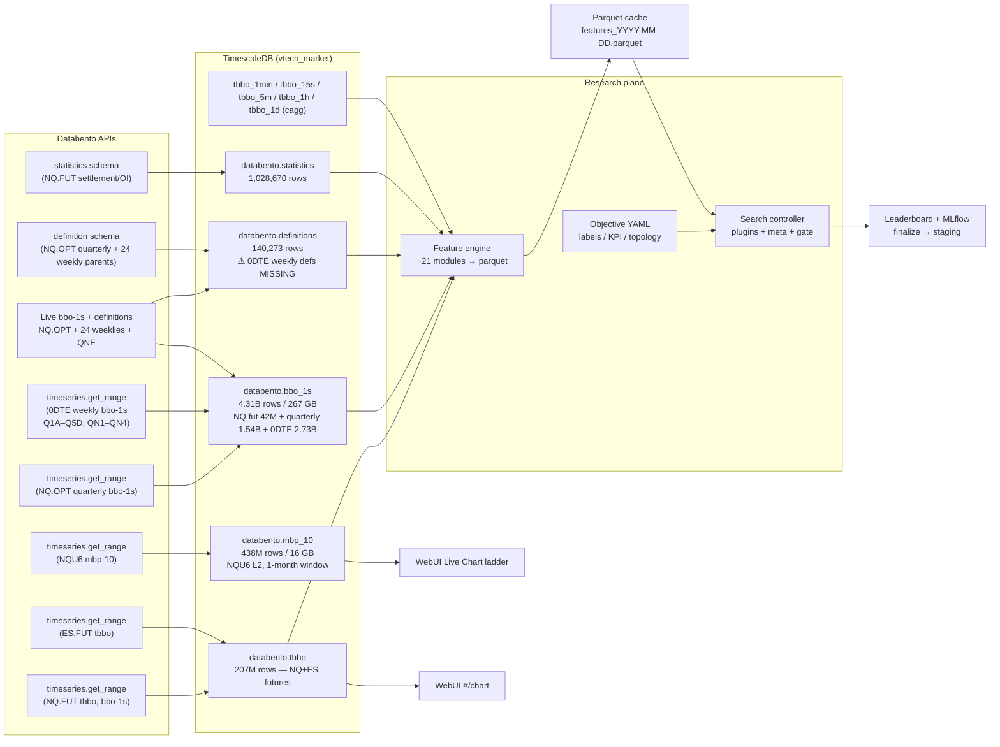
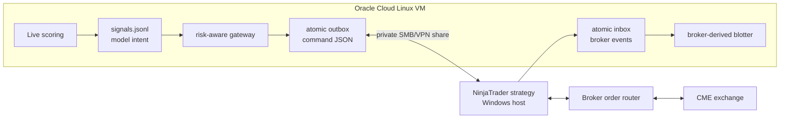

# System Architecture

> **Present**: CPU control plane + TimescaleDB + feature/search/agent/serving stack; External Models plane (`src/external_models`, ADR-058 / ADR-061 / ADR-062 / ADR-063 / ADR-064 / ADR-065 / ADR-096 Timed PSAR); execution gateway implemented but inactive (v8 layout map, 2026-08-06). Live streamer on CME hours; systemd MemoryMax=% of host RAM (ADR-060).
> **Supersedes**: v6 directory map (LSTM-centric); layout policy [ADR-028](../decisions/ADR-028-structure-first-layout-and-docs-workflow.md).  
> **Next**: P4 multi-family · P5 storage/greeks/IV · RD timer disabled (re-enable when operator approves) — [ROADMAP](../roadmap/ROADMAP.md).  
> **Source of truth for**: VM specs, runtime stack, service topology, directory layout, data flow.
>
> **Live facts** (re-check with `python -c "from src.common.vm_config import get_vm_config; print(get_vm_config())"`
> before sizing workers — the VM is resized by the operator). Do **not** copy GB/vCPU
> numbers from this file into systemd or Postgres. systemd `MemoryMax` is a **percent
> of host RAM at boot**; Postgres `shared_buffers` comes from
> `scripts/ops/apply_vm_resource_limits.py` ([ADR-060](../decisions/ADR-060-vm-relative-limits-and-cme-live-hours.md)).
> Adaptive FE/DL workers via `vm_config.workers_for()` (re-reads `os.cpu_count()` per
> process). Ephemeral OCI **GPU VM** is a separate execution plane (ADR-022).

---

## 1. Design Principles

| Principle | Rationale |
|-----------|-----------|
| **DBN-native storage** | Raw `.dbn.zst` files are the immutable archive and canonical source of truth (Databento zero-copy format) |
| **Three-tier data** | Raw DBN → TimescaleDB (queryable) → Parquet (ML-ready). Each tier is regenerable from the one above it. |
| **Objective-as-SSOT** | Trade objectives in `config/objectives/` own labels, session, KPI, costs, topology (ADR-018 / ADR-027) |
| **LLM proposes, code disposes** | Agents research and propose; search/gate/policy code executes and scores |
| **Schema-per-concern** | Futures, options, definitions, statistics in separate tables — clean boundaries, independent retention |
| **Batch for backfill, live for incremental** | Batch API for large history; Live API for real-time; paid downloads require cost gate |
| **No Docker for data pipeline** | systemd services — eliminates container overhead on I/O-critical path |
| **Idempotent ingestion** | Every pipeline stage is safe to re-run; dedup on `(instrument_id, ts_event, schema)` |
| **Single-source config** | `config.yaml` for non-secret knobs; `.env` for secrets only; env vars override YAML |

---

## 2. VM Specifications (CPU control plane)

| Resource | Spec (live — verify with `get_vm_config()`) |
|----------|------|
| **Provider** | Oracle Cloud |
| **CPU** | live `os.cpu_count()` — verify with `get_vm_config()` |
| **RAM** | live `/proc/meminfo` — verify with `get_vm_config()` |
| **Swap** | 2.0 GB (`/opt/vtech/data/swapfile`) + **zswap** compressed cache in RAM (`zstd`/`zsmalloc`, pool ceiling 20% of RAM), enabled by `systemd/vtech-zswap.service`. Sized 2026-10-06 — see `operations/DISK_RECLAIM_2026_10.md` §7-A |
| **Root disk** | OS, packages, code |
| **Data disk** | DB, Parquet cache, raw DBN archive |
| **GPU on this host** | None — training jobs may dispatch to ephemeral OCI GPU VM |
| **OS** | Ubuntu 22.04 LTS |

---

## 3. OS & Runtime Stack

```
Ubuntu 22.04 LTS
├── Python 3.10.12 (system)
├── Python 3.12.13 (venv at /opt/vtech/venv — all application code runs here)
├── PostgreSQL 18.3 + TimescaleDB 2.26.1 (apt repo)
├── systemd (service management)
└── Rust toolchain (dbn-cli for DBN inspection/transcoding)
```

### Core Python Dependencies (pinned in `requirements.lock`)

| Package | Version | Purpose |
|---------|---------|---------|
| `databento` | 0.75.0 | Databento client (Historical + Live APIs) |
| `pandas` | 2.3.3 | DataFrame operations |
| `numpy` | 2.2.6 | Numerical compute |
| `psycopg` | 3.3.3 | PostgreSQL async driver (psycopg3) |
| `pyarrow` | 23.0.1 | Parquet I/O |
| `tensorflow` | 2.21.0 | ML training (CPU mode) |
| `keras` | 3.13.2 | High-level model API (GPU jobs may save 3.15; serving load is ADR-077) |
| `scikit-learn` | 1.7.2 | Preprocessing, metrics, calibration |
| `scipy` | 1.15.3 | Wavelets, signal processing |
| `pywavelets` | 1.8.0 | Discrete wavelet transforms |
| `xgboost` | 3.2.0 | XGBoost baseline model |
| `shap` | 0.49.1 | Feature importance |
| `optuna` | 4.8.0 | Hyperparameter optimization |
| `python-dotenv` | 1.2.2 | `.env` file loading |
| `pyyaml` | 6.0.3 | `config.yaml` loading |

Full lockfile: `requirements.lock` (431 lines, generated via `uv pip compile`)

---

## 4. Directory Layout

> **As-built map** (packages that exist in the repo today). Dispositions and target nesting:
> [TREE_INVENTORY.md](TREE_INVENTORY.md), [ADR-028](../decisions/ADR-028-structure-first-layout-and-docs-workflow.md).
> Workflow across planes: [WORKFLOW.md](WORKFLOW.md).

```
/opt/vtech/   (or worktree checkout)
├── config.yaml                 ← Non-secret runtime knobs (objective_id, paths, …)
├── requirements.lock / pyproject.toml / Makefile / AGENTS.md / README.md
├── .env                        ← Secrets only
│
├── src/
│   ├── acquisition/            ← Databento historical + live_streamer
│   ├── ingestion/              ← DBN → TimescaleDB COPY / quality
│   ├── features/               ← engine + feature modules (incl. volume_footprint) + options greeks pipeline
│   ├── objectives/             ← load objective YAML
│   ├── models/                 ← plugin catalog, feature_views, tree/DL/regime plugins
│   ├── external_models/        ← Pine/rule replicas (not ML catalog; ADR-058/062/063/064/065/096)
│   ├── training/               ← labels, trainers, walk_forward, meta_labels (fit primitives)
│   ├── evaluation/             ← frozen contract, KPI criteria, episodes, patterns
│   ├── search/                 ← controller, gate, iterate, refine, meta_compose, meta_stack, custom_test, finalize
│   ├── backtest/               ← rule DSL + prediction path backtest
│   ├── serving/                ← serving bundle load + predict_canonical (Live/BT SSOT)
│   ├── execution/              ← risk gateway, atomic protocol, broker-event ledger
│   ├── scoping/                ← Stage-0 dual-perspective research (ADR-025)
│   ├── research_director/      ← model-improve orchestrator (as-built synthesizer loop)
│   ├── gpu_runner/             ← OCI Queue worker, job_exec, smoke
│   ├── webui/                  ← operator console
│   └── common/                 ← config, db, vm, oci_*, code_bundle, repro,
│                                 llm/ (factory+OpenAI+Anthropic+CostMeter), config_paths
│
├── config/
│   ├── objectives/             ← nq-50pt*.yaml + objective.schema.json
│   ├── external_models/        ← factory cards for External Models (ADR-058/062/063/064/065/096)
│   ├── agents/                 ← personas + duties YAML
│   ├── schemas/                ← JSON schemas (plans, manuals, critic, …)
│   ├── specs/                  ← manual/iterate/strategy/run candidate YAMLs
│   └── runtime/                ← research_director, scoping, meta_ab, oci_sync, execution gateway
│
├── scripts/                    ← data/ features/ search/ agents/ serving/ ops/ gpu/
├── tests/                      ← pytest suite
├── systemd/                    ← live-streamer, feature-builder, trainer, RD, execution gateway, mlflow, sync, backup, webui
├── deploy/                     ← GPU bootstrap, webui sudoers, NinjaTrader bridge source
├── research_cases/             ← papers + summaries (RAG corpus)
├── archive/                    ← superseded code/personas/docs
├── docs/                       ← architecture, decisions, roadmap, changelog, reference, operations
└── data/                       ← runtime (raw DBN, parquet*, model_staging, model_registry, search runs, logs)
    ├── raw/{backfill,live}/
    ├── parquet/ | parquet_raw1s/ | parquet_path1s/ | parquet_pathlabels/ | parquet_options_*
    ├── sources/features/timeframe=5s/symbol=NQ/year=/month=/features_5s_partN.parquet  ← 5s hive (ADR-079)
    ├── sources/features/timeframe=15s/symbol=NQ/year=/month=/features_15s_partN.parquet  ← native 15s (ADR-075)
    ├── sources/features/timeframe=1m/symbol=NQ/year=/month=/features_1m_partN.parquet  ← native 1m (ADR-085)
    ├── sources/features/timeframe=5m/symbol=NQ/year=/month=/features_5m_partN.parquet  ← native 5m (ADR-090)
    ├── sources/features/timeframe=1h/symbol=NQ/year=/month=/features_1h_partN.parquet  ← native 1h HTF (ADR-091)
    ├── sources/features/timeframe=1d/symbol=NQ/year=/month=/features_1d_partN.parquet  ← native 1d HTF (ADR-091)
    ├── models/{leaders,model_staging,model_registry}/
    ├── search/ | custom_test/ | evaluation/ | scoping/ | research_director/
    ├── ops/execution/          ← gateway state + default local outbox/inbox bridge
    ├── ops/gpu_jobs/           ← live GPU job heartbeat + per-fold OOF (ADR-073)
    ├── ops/gpu_health/         ← CPU-side SSH watchdog latest.json / alerts.jsonl
    ├── ops/webui/external_models/ ← EXT defaults + hardened + _book (ADR-058/062/063/064/065/096)
    └── checkpoints/            ← legacy training dirs (prefer staging/registry)
```

**Import convention (ADR-028):** `from src.<pkg>…` and `python -m src.<pkg>…` with
`PYTHONPATH` = repo root (e.g. `/opt/vtech`). Research Director migrated 2026-08-05.

**LLM substrate:** all agentic processes construct clients via `src.common.llm.make_llm`
(Anthropic + OpenAI-compatible). Plane-local `research_director.llm` / `scoping.anthropic_llm`
are **shims only**.

---

## 5. Data Flow



### 5.1 Broker execution topology



The Windows host may be a local workstation, cloud Windows VM, or broker-adjacent
machine. It is not part of the Linux VM. The bridge is a shared directory visible
as a Linux mount and Windows path; never expose SMB directly to the public Internet.
The gateway/service and NinjaTrader source exist, but the service is not installed,
enabled, or started and runtime configuration remains `enabled: false`.

---

## 6. Service Orchestration

Status is live-checked on the host (`systemctl is-active …`). Typical steady state:

| Service | File | Schedule | Role | Status (2026-08-06) |
|---------|------|----------|------|---------------------|
| `vtech-live-streamer` | `live_streamer.service` + CME timers | Sun 5pm–Fri 4pm CT (boot resume on weekdays; skip if started on weekend) | Databento live → TimescaleDB | ✅ Active |
| `vtech-feature-builder` | `feature-builder.service/.timer` | Daily | Parquet feature build | ✅ Timer active |
| `vtech-mlflow` | `mlflow.service` | 24/7 | Experiment tracking UI/API | ✅ Active |
| `vtech-webui` | `vtech-webui.service` | 24/7 | Loopback-only operator console; access via SSH tunnel | ✅ Active + enabled |
| `vtech-oci-sync` | `oci-sync.service/.timer` | Daily | Object Storage durability | ✅ Active |
| `vtech-mbo-incremental` | `mbo-incremental.service/.timer` (`scripts/ops/mbo_incremental_pull.py`) | Every 30 min, CME session hours | Keeps `databento.mbo` current: $0-gated, checkpointed on the table's own `max(ts_recv, sequence)`, append-only (never deletes). Also writes a dated checkpoint into `databento.mbo_resting_orders` each tick, backfilled from MBO inception (ADR-147). True live MBO streaming stays disabled (ADR-146); this is the interim architecture | ✅ Timer active (2026-09-29) |
| `vtech-mbo-daily` | *(retired 2026-09-29, ADR-146)* `scripts/ops/daily_mbo_pull.py` | Manual only | Superseded by `vtech-mbo-incremental` above for day-to-day currency. Kept as the manual whole-day gap-fill tool for a hole that predates the incremental timer's own start, $0-gated, disk-guarded, count-verified | ⛔ Timer removed; run by hand |
| `vtech-gpu-health-monitor` | `gpu-health-monitor.service` | 24/7 | GPU plane health | ✅ Active |
| `vtech-pg-backup` | `pg-backup.service/.timer` | Daily | pgBackRest → archive | Timer enabled |
| `vtech-research-director` | `research-director.service/.timer` | 00/06/12/18:30 UTC | RD model-improvement cycle | ⏸ Timer **disabled** (2026-08-12); model_rates live; $20 session / $20 day caps |
| `vtech-trainer` | `trainer.service/.timer` | Optional | Legacy scheduled train | Optional |
| `vtech-execution-gateway` | `vtech-execution-gateway.service` | 24/7 when armed | Signals → risk checks → NinjaTrader outbox | ⛔ Unit source only; not installed/enabled |

**Restart sequence** (Phase 17, Live Data):
```bash
sudo systemctl start vtech-live-streamer
sudo systemctl enable vtech-feature-builder.timer
sudo systemctl enable vtech-trainer.timer
```

**OCI sync** runs automatically via timer. Manual trigger:
```bash
bash /opt/vtech/scripts/ops/sync_to_oci.sh --dry-run   # preview
bash /opt/vtech/scripts/ops/sync_to_oci.sh             # live
```
See [operations/OCI_SYNC.md](../operations/OCI_SYNC.md) for full runbook.

---

## 7. Object Storage

Two Standard-tier OCI buckets in **`us-phoenix-1`** (namespace `axt3twx03ybb`):

| Bucket | Intended use | Current contents |
|--------|-------------|-----------------|
| `vtech_archive` | Cold reference data, raw DBN snapshots, checkpoints, **PostgreSQL backups** | `raw/backfill/definitions/` (22.8 MB) + `pgbackrest/` (pending credentials) |
| `vtech_hot` | GPU feature caches + model registry | `parquet_raw1s/`, `parquet_path1s/`, `parquet_pathlabels/`, `labels/{5s,15s}/<contract_id>/`, `timeframe={5s,15s,1m,5m,1h,1d}/` (hive-relative keys, ADR-078 / ADR-081 / ADR-107), `model_registry/` |

**File sync** (non-DB files): `scripts/ops/sync_to_oci.sh` + `config/runtime/oci_sync.conf`. Credentials in `~/.oci/config` (OCI CLI API key). See [operations/OCI_SYNC.md](../operations/OCI_SYNC.md).

**PostgreSQL backups**: pgBackRest 2.58.0, stanza `vtech`, writes to `vtech_archive/pgbackrest/`. Uses OCI S3-compat API with Customer Secret Keys (separate from OCI CLI key) stored in `/etc/pgbackrest/pgbackrest.conf` (root:postgres 640). WAL archiving enabled (`archive_mode=on`); **PostgreSQL restart required before archiving activates**. See [operations/PG_BACKUP.md](../operations/PG_BACKUP.md).

---

## 8. Core Parameters

Session, labels, and KPI are owned by the **active objective** (`config.yaml` → `objective_id`
→ `config/objectives/<id>.yaml`). Feature-engine knobs remain in `config.yaml`.

| Parameter | Typical value | Source |
|-----------|---------------|--------|
| Active objective | `nq-50pt` (pin in config.yaml); economics proof: `nq-50pt-econ` | `config.yaml` / objectives |
| Feature timestep | **5s** | `config.yaml` `dataset parameters` |
| Sequence length | **128 bars** (~10.7 min @ 5s) | `config.yaml` `model hyperparameters` |
| Trading session | **08:00–14:45 America/Chicago** (objective) | objective `session` |
| Feature groups | 24 modules / 242 cols (views select subsets; `ps_` ADR-055, `vf_` ADR-056) | feature engine + `feature_views.py` |
| Seed | **42** | `training.seed` |
| Label schemes | Detection-2 or Triple Barrier | objective `labels.scheme` |
| Champion ranking | `precision_at_tau` (legacy) or `net_expectancy` (`nq-50pt-econ`) | objective `kpi.primary` |

---

## 9. CME Roll Date Reference

| Quarter | Expiry Date | Roll Date | Active Contract |
|---------|-------------|-----------|----------------|
| 2025 Q3 | Sep 19, 2025 | Sep 15, 2025 | NQZ5 / ESZ5 |
| 2025 Q4 | Dec 19, 2025 | **Dec 15, 2025** | NQH6 / ESH6 |
| 2026 Q1 | Mar 20, 2026 | **Mar 16, 2026** | NQM6 / ESM6 |
| 2026 Q2 | Jun 18, 2026 | Jun 15, 2026 | NQU6 / ESU6 |

Roll rule: Monday prior to the third Friday of the expiry month. Computed algorithmically in `src/common/contract_calendar.py` — no hardcoded table needed.

---

## 10. Known Issues & Open Blockers

| Issue | Severity | Notes |
|-------|----------|-------|
| Full live paper-trade → T3 proven journal loop | Med | P2 limit+OCO engine + TBBO stream/replay; enable RTH service + multi-week KPI still open |
| RD/Scoping convergence (shared RAG/critic) | Medium | Scoping v2 live; RD rebuilt on same primitives — finish shared substrate |
| ES / cross-asset feature coverage | Medium | Depends on live subscriptions + history |
| Doc drift risk | Low | Prefer runtime tools + ADRs; re-verify `get_vm_config()` before hardware claims |

---

## Related Docs

- [DATA_PIPELINE.md](DATA_PIPELINE.md) — acquisition → ingestion detail
- [FEATURE_ENGINE.md](FEATURE_ENGINE.md) — engine internals
- [ML_MODEL.md](ML_MODEL.md) — model architecture and training
- [DATABASE_SCHEMA.md](DATABASE_SCHEMA.md) — full DDL
- [ADR-005](../decisions/ADR-005-continuous-contract-calendar.md) — why CME calendar-based contract selection
- [ADR-006](../decisions/ADR-006-config-yaml-single-source.md) — why config.yaml
- [operations/TROUBLESHOOTING.md](../operations/TROUBLESHOOTING.md) — known error patterns
