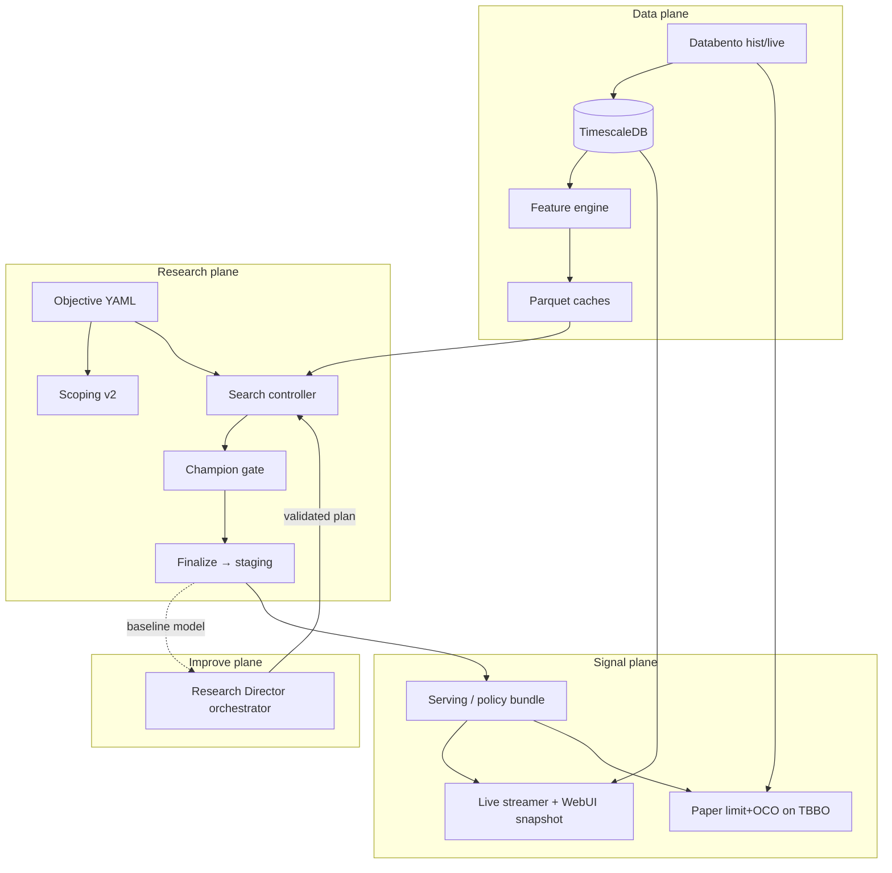

# System Workflow Map

> **Present**: End-to-end planes as implemented in code (2026-08), including WebUI Custom Test (ADR-036 routing + ADR-040 params/HPO + ADR-042 calendar walk-forward + ADR-071 report-only, no champion gate + ADR-074 saved views / expand-on-assign); opt-in 3×3 expected-cost train loss on `nq-50pt-tbm-opt` (ADR-072); GPU job heartbeat + per-fold OOF (ADR-073); External Models tab `#/external` (ADR-058/062/063/064/065/096 SAR + 20 EMA + ZigZag High/Low + Timed PSAR engines; stackable Backtest EXT Model with **Backtest Parameters** — session vs trade window, per-engine candle TF including 1hour/1day, PT/SL/min-ATR units and PT × stop; ADR-061 `exit_at_sar` on SAR; catalog list is YAML-only, `tbbo_1min` on Backtest run; Chart omits CME holiday dates); `#/backtest` ML confidence % 5–95 with optional gate (native-TF last-fold bundles score their own hive, ADR-100); Keras first-party `.keras` load (ADR-059 / ADR-077 Keras 3.15 initializer keys; ADR-082 dual-binary LSTM serve packs `long_ctx`/`short_ctx`); Live health probes time-bounded (2026-08-20); Live Chart `#/chart` (ADR-087 / ADR-097 / ADR-105 custom lookback / ADR-124 custom date range / ADR-125 hover session VP / ADR-108 nested overlay params + Volume Profile SSOT / ADR-109 viewport fit + night-session display + VA wash extend / ADR-111 large prints / ADR-112 stacked panes / ADR-114 replay / ADR-117 grouped ticks and bilateral displays / ADR-118 total-volume delta overlay; `#/border` alias) reads TBBO candles, per-overlay CVD/OFI origins, Volume Profile overlays, optional MBP-10 ladder. The Live Chart page fills the browser viewport (sidebar overlays scroll separately).  
> **Supersedes**: Implicit workflow scattered across phase docs.  
> **Next**: P4 multi-family · P5 storage/greeks/IV — [ROADMAP](../roadmap/ROADMAP.md).  
> **Source of truth for**: how data, research, models, and live signals relate.

---

## 1. Planes

| Plane | Code home | Operator entry |
|-------|-----------|----------------|
| **Data** | `src/acquisition`, `src/ingestion` | `scripts/download_*`, `ingest_dbn`, live streamer service |
| **Features** | `src/features` | `python -m src.features.engine`, rebuild scripts |
| **Objectives** | `config/objectives`, `src/objectives` | pin `objective_id` in `config.yaml` |
| **Models** | `src/models` | plugin catalog |
| **External models** | `src/external_models` | WebUI `#/external` (SAR + 20 EMA + ZigZag + Timed PSAR; ADR-058/062/063/096) |
| **Training** | `src/training` | fit primitives (labels, trainers) |
| **Evaluation** | `src/evaluation` | frozen contract + KPI + episodes + XGB SHAP |
| **Search** | `src/search` | `python -m src.search.controller` / iterate / refine |
| **Backtest** | `src/backtest` | `python -m src.backtest.runner` |
| **LLM (shared)** | `src/common/llm` | `make_llm()` — not owned by scoping or RD |
| **Agentic harness (shared)** | `src/agentic` | registry, RAG research, critic, embeddings, memory (ADR-030) |
| **Paper (live, no money)** | `src/paper` | Databento TBBO stream → limit entry + OCO bracket; `python -m src.paper.runner --stream` |
| **Broker execution** | `src/execution` | Risk gateway → atomic command outbox → NinjaTrader acknowledgements/fills (ADR-032) |
| **Scoping (Stage-0)** | `src/scoping` | scoping runner (pre-search research) |
| **Research Director** | `src/research_director` | `python -m src.research_director.run` |
| **GPU execution** | `src/gpu_runner`, `src/common/oci_*` | OCI Queue + code bundles (ADR-022); live heartbeat `ops/gpu_jobs/<run_id>/` (ADR-073); native-TF hydrate `timeframe={tf}/` + labels sidecar (ADR-078) + 1h/1d HTF context (ADR-102) |
| **Serving** | `src/serving` | Live + Backtest SSOT predict; tf_oof_meta asof (ADR-103) is Backtest-only |
| **UI** | `src/webui` | console (`#/chart` = Live Chart /NQ; `#/external` = Pine replicas; Backtest **Chart** tab) |

---

## 2. Happy path (research → champion)



---

### Signal export and broker execution boundary

`src.webui.live.build_snapshot()` scores 5-second feature bars and appends only
qualifying, newly fired rows to `data/live/signals.jsonl`. This is an immutable
**signal ledger**, not an order protocol. The Registered Model signal table reads
the same records.

Emission is gated by the Registered Model's effective session start/end controls
for the current objective session in its IANA timezone (normally
`America/Chicago`). JSONL timestamps remain UTC. Pre-open and post-close bars are
not emitted, and a service restart outside that session cannot replay historical
bars into the broker feed. The ledger reapplies that same timestamp predicate, so
retained invalid historical rows are excluded from the UI.
`data/live/heartbeat.json.signal_export_window` records the effective window used.

Before Live predicts or exports a broker-facing row, the candidate 5-second bar
must satisfy a **full finite + fresh** contract:

1. Every feature in the serving bundle's `feature_cols` is finite.
2. While `in_session=true`, the selected bar timestamp is no older than
   `_LIVE_AGE_S=15s` versus current UTC time.

If either condition fails, Live stays `warming`, publishes only truthful
coverage metadata (`bar_ts`, present/missing counts, `signal=false`), clears
the ledger, and emits nothing to `signals.jsonl`. Outside the configured
session, historical/end-of-session display behavior remains allowed.

To keep `/api/live/streamer` responsive while `FeatureEngine.build_date(...)`
runs, WebUI lifecycle scheduling uses one spawned (`multiprocessing` `spawn`)
snapshot worker process at a time. The worker atomically writes each completed
snapshot (`ok`/`warming`/`error`) to `ops/webui/live_snapshot_cache.json`
(temp write + rename), and request handlers read only that cache + cached
streamer health (no DB calls on polling endpoints; the background health
loop uses time-bounded `tbbo`/`statistics` probes only — never unbounded
`max(ts_event)`, never `bbo_1s`). TBBO DATA blotter is the same pattern:
`/api/live/ledger?mode=ticks` reads an in-process cache; the full-day paper
replay runs on a background thread.

`src.execution.gateway` tails complete signal lines, applies fail-closed risk
checks, and publishes one versioned JSON command per deterministic `command_id`.
Publication is atomic: write and `fsync` a hidden temporary file, then rename it
inside the same directory. NinjaTrader polls only final `*.json` names, so it sees
no command or the complete command, never partial JSON.

The NinjaTrader strategy in `deploy/ninjatrader/` independently validates command
TTL, exact account, exact contract, SIM/LIVE mode, flat strategy position, and the
shared kill switch before submission. NinjaTrader owns the broker-native entry and
OCO bracket. It writes immutable acknowledgement/order/fill events to the inbox.
`src.execution.ledger` derives the separate broker blotter only from those events;
paper fills and signal prices are never broker truth. See
[ADR-032](../decisions/ADR-032-risk-gateway-atomic-broker-protocol.md) and the
[NinjaTrader runbook](../operations/NINJATRADER_EXECUTION.md).
---

## 3. Entry paths (experiments)

| Path | When | Mechanism |
|------|------|-----------|
| Automated search | New/continued model selection | `src.search.controller` + families/catalog (`output_meta` / `meta_stack` from objective topology). `nq-50pt-econ-lg-st` trains topology bases per native store (LSTM 15s seq_len=60 + keeper XGB HPs, slim 1h/1d pack on the frames, fire 0.40, [ADR-095](../decisions/ADR-095-regime-context-fire-aux.md)) then OOF meta ([ADR-093](../decisions/ADR-093-tf-oof-meta-joint-search.md)); OOF-only recompose is `python -m src.search.tf_oof_meta` ([ADR-092](../decisions/ADR-092-tf-oof-meta-composer.md)) |
| Manual candidates | Operator pins models/features | ADR-019 + `manual_candidates*.yaml` |
| **Custom Test** | WebUI: pick models, click a card for catalog params / opt-in HPO, drag views/groups/columns (views/groups expand to columns; **save as view** reuses the subset), or **＋ all features**, ablate, optional meta, calendar walk-forward | [ADR-035](../decisions/ADR-035-webui-custom-test.md) / [ADR-040](../decisions/ADR-040-custom-test-params-hpo.md) / [ADR-042](../decisions/ADR-042-custom-test-calendar-walk-forward.md) / [ADR-071](../decisions/ADR-071-optional-champion-gate.md) / [ADR-074](../decisions/ADR-074-custom-test-saved-feature-views.md) — compiles to manual spec + `--topology-overlay` + `--walk-forward-overlay`. **No champion gate**; `run.json` is `status: report`. Default calendar: 2025-05-01→2026-06-30, 2-month train/test. Default board from the objective (`nq-50pt-xgb-tcn` = XGB+TCN + logistic `meta_stack`). Saved views live in `ops/webui/custom_feature_views/`. Backtest **Browse…** can replay the run’s `oof_*.parquet` without promote. |
| Iterate-until-target | HPO + feature choices | `src.search.iterate` |
| Feature refine | Add/remove features from patterns | `src.search.feature_refine` |
| Rule strategy | Non-ML rules/cadence | `src.backtest` + strategy spec (ADR-020) |
| **External Models** | Pine/rule replicas with editable knobs | WebUI `#/external` → Backtest type **EXT Model** ([ADR-058](../decisions/ADR-058-external-models-pine-sar-ema.md), [ADR-061](../decisions/ADR-061-psar-ema-exit-at-sar.md), [ADR-062](../decisions/ADR-062-ext-model-split-and-stack.md), [ADR-063](../decisions/ADR-063-zigzag-high-low.md), [ADR-064](../decisions/ADR-064-ext-trade-window-tf-units.md), [ADR-065](../decisions/ADR-065-ext-hour-day-timeframes.md), [ADR-096](../decisions/ADR-096-ext-timed-psar.md)). Engines: Parabolic SAR, 20 EMA, ZigZag High/Low, Timed PSAR (clock or bars-from-open; 1h/1d SAR direction; one fill per session). Shared **Backtest Parameters** on `#/backtest` when EXT Model is selected: session vs trade-entry window, per-engine candle timeframe (`1min`/`5min`/`15min`/`1hour`/`1day`), ATR gate, PT/SL (points, × ATR, or PT × stop), sides, costs. Stacked engines AND: matching sides enter, opposing/flat exit. Tab lists YAML + overlays (no warehouse scan). Optional `exit_at_sar` on the SAR card. Candles from `databento.tbbo_1min` on Backtest **run**, not 5s features. Chart and EXT `n_sessions` omit CME holiday dates (same `cme_holidays` set as the book). Not an ML catalog family. |
| Scoping v2 | Pre-run data/model scope | ADR-025 |
| RD improve | Continuous model improvement | orchestrator (as-built synthesis) |

All ML paths should score through the **same frozen evaluation contract** for a given `objective_id`.

---

## 4. Live display vs paper execution

### Live / Backtest **tabs** — shared **TBBO DATA** toggle

Both consoles share a **TBBO DATA** on/off switch (default **off**). Inference is always
`src.serving` on staged/registry weights; only the **fill / blotter path** changes:

| Toggle | Fill path | Notes |
|--------|-----------|--------|
| **off** (default) | Dataset default — currently 5s feature **`_close`** first-touch | May differ per dataset later |
| **on** (TBBO DATA) | **Backtest:** gate long/short signals (conf ≥ τ), then resolve each on Databento TBBO inside the horizon (default 10m). Long: trade **or ask** touches target/stop; short: trade **or bid**. Barrier hits book fixed ±target/stop (MAE / profit-target adjustments). | Independent per signal — not portfolio stacking |

1. Market data for **features**: TimescaleDB → `FeatureEngine` → 5s feature parquet.
2. Inference: `src.serving.predict_canonical` on those bars.
3. **TBBO DATA off**: path backtest / blotter on `_close`.
4. **TBBO DATA on (Backtest)**: only signal rows are walked against TBBO in each signal's horizon window.

### Paper CLI (P2 — always true-path prints)

1. **Fills** driven by **Databento trade prints** (Live client `tbbo` on `NQ.FUT`, or
   offline replay of `databento.tbbo` in event order).  
2. On model signal → **resting limit entry** (`entry_style`: `last` | `join` | `cross`).  
3. On entry fill → **OCO bracket**: target limit (+`move_threshold`) + stop
   (`mae_tolerance`), e.g. nq-50pt-econ **+50 / −6**. First fill cancels sibling.  
4. Unfilled entry expires after `entry_timeout` (default 60s). EOD / max-hold force flat.  
5. Ledger: `ops/paper/<objective_id>/` (`trades.jsonl`, `events.jsonl`, `summary.json`).  

```bash
# Live paper (own Databento Live session for prints)
python -m src.paper.runner --stream --objective nq-50pt-econ

# Offline true-path test (same fill engine, TBBO from Timescale)
python -m src.paper.runner --replay-db 2026-08-04 --objective nq-50pt-econ
```

Optional systemd: `systemd/vtech-paper.service`.

---

## 5. Model lifecycle (search → stage → registry)

```text
research/search/<objective>/<run_ts>/
        │  oof_<cand>.parquet             # walk-forward tape (automated search)
        │
research/custom_test/<objective>/<run_ts>/models/<cand>/
        │  last-fold serve bundle + oof.parquet (Custom Test; ADR-036)
        │  meta_stack__<bases>/ stack bundle; meta__<primary>/ primary_meta gate
        │    (meta.pkl + copied bases/<primary>/)
        │  python -m src.search.finalize --objective <id>   # optional full-matrix refit → staging
        │  python -m src.serving.promote --staging-dir <run>/models/<cand>
        ▼
models/model_staging/<objective>/<id>/    # serve bundle (kept if not promoted)
        │  python -m src.serving.promote --staging-dir …   # human gate
        ▼
models/model_registry/<objective>/
  LATEST.json  +  <id>/                   # production
```

- **Custom Test** (`--experiment-type custom_test`) writes last-fold serving folders at `research/custom_test/<obj>/<run_ts>/models/<cand>/` — same files as staging (`model.ubj`/`model.keras`/`model.pkl`, `scaler.pkl`, `feature_schema.json`, `finalize_manifest.json`) plus `oof.parquet` / `diagnostics.json`. Champion gate is **not** applied ([ADR-071](../decisions/ADR-071-optional-champion-gate.md)); `run.json` is `status: report` with no `gate_result`. Search / HPO / scoping still pick a champion when the objective sets `kpi.champion_gate: true`. `primary_meta` is `models/meta__<primary>/` (`meta.pkl` + `meta.json` + copied `bases/<primary>/`); `meta_stack` is `models/meta_stack__<bases>/`. GPU `job_exec` uploads `models/**`; the collector prefix-lists the results outbox. Before enqueue the CPU **pushes** `features_*.parquet` to `vtech_hot` (predictive hive + labels; 1h/1d HTF when `topology.context` is set, [ADR-102](../decisions/ADR-102-gpu-htf-context-hydrate.md)); the GPU job size+mtime-syncs them (ADR-041). `#/backtest` lists Custom Test `models/<cand>/` serving folders and OOF-only lab dirs (`oof.parquet`); historical replay is as-of on that store's hive ([ADR-100](../decisions/ADR-100-backtest-native-tf-bundle-store.md)). While a GPU job is running, fold/epoch/`%` live at `ops/gpu_jobs/<run_id>/progress.json` on the GPU ([ADR-073](../decisions/ADR-073-gpu-job-progress-heartbeat.md)) — `make gpu-monitor` (or `make gpu-watch` / `make gpu-follow`). Specs under `ops/webui/custom_tests/` infer `custom_test` if the flag is omitted. Automated search stays OOF-only under `research/search/`. Promote a lab folder or finalize into staging first. Start the console from `/opt/vtech` (`make webui`; not a Grok worktree). Keras last-fold files (TCN `pooling=last`) load via `load_keras_model` (ADR-059) — Python-lambda `Lambda` layers are not used in new graphs.
- **Causal long timer (ADR-047)** for `#/backtest`: `python -m src.search.finalize --objective nq-50pt-xgb-unique --candidate xgb_causal_topgroups --run data/research/search/nq-50pt-xgb-unique/20260821T110058Z` writes `model_staging/nq-50pt-xgb-unique/xgb_causal_topgroups_20260821T110058Z/` including `inference_policy.json`. Backtest applies that policy (open window, long-only, 10m uniqueness, last-fold τ=0.50). **Not promoted.** Live pin is still `nq-50pt-econ`.
- **Backtest confidence %** on `#/backtest` (ML): dropdown **5%–95%** (5% steps, default 80%). **enable** (default on) applies `conf ≥ τ`; uncheck sends `confidence_gate: false` so directional predictions enter without a τ filter (inference-policy window / side / cooldown still apply). Dual-binary last-fold **1m/5m** bundles load their own hive ([ADR-100](../decisions/ADR-100-backtest-native-tf-bundle-store.md)). Dual-binary **OOF replay** uses the UI τ as the event cut ([ADR-104](../decisions/ADR-104-lstm-session-pmax-and-ui-tau.md)); uncheck τ replays at library fire 0.1. Do not score 1m/5m bundles on the 15s grid.  
- **Live / paper**: registry `LATEST` preferred, else staging.  
- **Research Director**: cycles **each** objective that has registry `LATEST` **and** RD enabled (WebUI Objectives toggle → `ops/webui/rd_objectives.json`).

## 6. Principles (do not violate)

1. **Objective YAML owns labels/KPI/costs/topology** (ADR-018/027).  
2. **LLM proposes; code disposes** — gates, costs, registry, downloads.  
3. **No paid Databento download without live operator approval.**  
4. **Human-gated promotion** to registry / live-serving defaults.  
5. **Docs**: architecture = present; roadmap = future; changelog = past (ADR-028).

---

## 6. Related docs

| Doc | Role |
|-----|------|
| [SYSTEM.md](SYSTEM.md) | VM, services, directory layout |
| [DATA_LAYOUT.md](DATA_LAYOUT.md) | Runtime `VTECH_DATA_DIR` (staging, parquet, search, …) |
| [TREE_INVENTORY.md](TREE_INVENTORY.md) | Path dispositions |
| [RESEARCH_DIRECTOR.md](RESEARCH_DIRECTOR.md) | RD design + as-built note |
| [DATA_PIPELINE.md](DATA_PIPELINE.md) | Tiers and acquisition |
| [ML_MODEL.md](ML_MODEL.md) | Labels and training |
| [ADR-028](../decisions/ADR-028-structure-first-layout-and-docs-workflow.md) | Structure-first decision |
