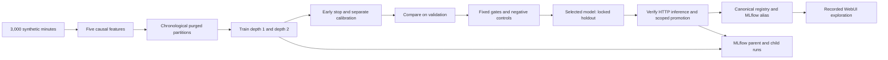

# Robin: a complete small-scale Transformer workflow

Robin is the display name for the `synthetic-regime-service` example. Its purpose
is to demonstrate authentic ML orchestration on a modest, understandable problem.
It is not a trading model or evidence of profitable financial prediction.

## Start the recorded example

Use a fresh **Linux/Python 3.12** environment. The validated OCI machine is ARM64;
the CPU training requirements also select the CPU-only TensorFlow distribution
on Linux x86-64. Other operating systems have not been validated. The training
supervisor and source bundling use POSIX functionality.

```bash
python3.12 -m venv .venv
source .venv/bin/activate
python -m pip install -r requirements-showcase.lock
python -m pip install -e .
python -m src.showcase prepare --output .demo-output/robin
python -m src.showcase serve --output .demo-output/robin
```

Open http://127.0.0.1:8700 and http://127.0.0.1:5000. Ctrl+C stops both services.
Use `--port` and `--mlflow-port` if those ports are occupied. On a remote VM,
forward both ports through SSH or your editor. The launcher binds localhost.
Reopening uses `serve` only; preparation refuses an existing output directory.
No `.env`, PostgreSQL service, cloud account, data download or training is needed.
Initial Python package installation requires Internet access; viewing uses local
assets. The viewer dependencies include MLflow; TensorFlow is optional.

Do not layer `requirements-demo.lock` onto this environment. The lightweight
logistic demo uses newer scientific packages, while MLflow 3.10.1 requires
PyArrow below 24. The showcase pins the versions used by the original model,
including scikit-learn 1.8.0 for the retained scaler and PyArrow 23.0.1.

## What the data and model mean

The dataset contains **3,000 consecutive invented minutes**, not vendor data.
An artificial price moves through noisy down, flat and up regimes. Five causal
features describe recent changes, short momentum, volatility and a noisy current
regime sensor. A 12-minute input window predicts the class of the next four
minutes. Labels and forward prices are future outcomes, never model inputs.

The model learned to recognize these simple synthetic regimes from their recent
history. The noisy sensor persistence rule is already a strong baseline; the
Transformer's passing result does not establish general market intelligence.

| Record | Value |
|---|---|
| Original run | `20261015T032845Z_c77c70f8` |
| Objective | `synthetic-regime-service` |
| Exact dataset | `examples/transformer-regime/synthetic.parquet`, 235,766 bytes |
| Dataset SHA-256 | `150a89b38646ce3e2d46baf55671ba75faf1e05488ac46faa67fcf536a0a47e8` |
| Synthetic timestamps | 2024-01-02 14:30 UTC through 2024-01-04 16:29 UTC |
| Compared designs | Encoder depths 1 and 2; depth 2 selected on validation loss |
| Validation | 435 predictions per design |
| Locked holdout | 289 predictions for the selected design |
| Original holdout accuracy / macro F1 | 0.934256 / 0.934081 |
| Original holdout log loss | 0.242030 |
| Persistence baseline accuracy / log loss | 0.934256 / 0.256822 |
| Original end-to-end supervisor time | 68.6 seconds on the source VM |

The public fixture preserves exact dataset/native model bytes. JSON evidence
that contained operational absolute paths is explicitly projected: each retained
file records its original hash, and the export manifest explains the mapping.
The original operator deployment code bundle is excluded. Native weights loaded
with reviewed X source reproduce the original probabilities; rebuilding a public
inference package changes its package hash and is not presented as the original
operator package.

## Workflow and gates



The five chronological partitions allocate 55% to training, 10% to early stopping,
10% to calibration, 15% to validation and 10% to the holdout. Boundaries purge
forward label overlap; the model also needs an 11-row sequence warmup. Scaling
uses training data only. Calibration does not use validation or holdout labels.
The chosen design is frozen before final holdout evaluation.

Both validation and holdout require all eight frozen checks:

- Accuracy and macro F1 each at least 0.80.
- Every class recall at least 0.75.
- At least 200 predictions, with at least 50 examples per class.
- Log loss at most 0.60.
- At least 25% lower log loss than the training-prior baseline.
- Accuracy no more than five percentage points below the train-fitted sensor
  persistence baseline.

Prior-only and shuffled-prediction negative controls must be rejected. Promotion
also authenticates model/data/prediction hashes, verifies calibrated HTTP
inference, resolves the MLflow alias and creates the canonical registry pointer.
`promotion_completion.json` records final success; training completion alone does
not establish promotion. The `PRODUCTION` lifecycle and `test-serving` alias
apply only to this synthetic classification service. Diagnostic synthetic P/L
is displayed but is not used as a financial promotion claim.

## Guided WebUI tour

| Tab | Try this | Actual evidence |
|---|---|---|
| Dashboard | Follow the workflow links | Dataset, selected design, holdout result and provenance |
| Data / Features | Choose a feature and partition; toggle the separate future-outcome panel | All 3,000 original rows, real timestamps, purged partitions |
| Models | Switch depths; select the winner's holdout population | Recorded probabilities, parameters, validation comparison and baselines |
| Backtest | Switch designs and inspect entries/equity | 70 winner trades or 75 alternate trades from saved validation ledgers; explicit costs |
| Evaluation / Promotion | Inspect each threshold and the rejected controls | Eight gate verdicts and original promotion evidence |
| Artifacts | Download a file and open the linked MLflow runs | Allowlisted checksummed artifacts and original/local ID mapping |
| Live capabilities | Read available scope | No fabricated order-book, trade-volume or live-feed data |

The console reuses the platform's styling/navigation vocabulary in an isolated
file-backed profile. It does not import the operational application or start its
job manager, live worker, vendor connectors or PostgreSQL queries. All mutation
requests are refused. `python -m src.webui.app` remains the operational console;
the documented showcase launcher is the database-free entry point.

## Storage and MLflow

```text
examples/transformer-regime/          # versioned, immutable public source fixture
  synthetic.parquet
  showcase_manifest.json             # paths, sizes, hashes and provenance
  evidence/                          # reviewed original-result projections
  predictions/holdout.parquet         # timestamped view derived from original NPZ
  models/<design-id>/                 # exact weights/scaler, predictions, ledgers
  mlflow_export.json                 # original params, metric history and source IDs
.demo-output/robin/                   # ignored generated visitor state
  showcase.json                     # relative pointers and import ID mapping
  research/runs/<objective>/<run>-recorded/
  models/model_registry/<objective>/recorded-example/
  ops/mlflow_artifacts/<generation>/ # fresh local SQLite + imported artifacts
```

The importer uses the MLflow API, not a copy of the operator's SQLite database.
A fresh parent and two children retain `source_run_id`, original run times,
source dataset hash and `evidence_kind=recorded_example` tags. Imported runs have
new IDs and import times. Original `test-serving` registry evidence is displayed;
it is not silently recreated as a new local promotion. The original parent ID
is `1aaf47dfd7454e5fa96fcad14f7b68d4`.

Moving a prepared output is supported: the next `serve` verifies the fixture and
imports into a fresh local tracking generation so MLflow's absolute artifact
URIs resolve at the new location. Earlier imported databases, pointers and ID
mappings are preserved. Original source IDs continue to identify the training
execution. Source fixtures remain untouched.

## Run the model for real

```bash
python -m pip install -r requirements-transformer.lock
python -m src.experiment.transformer_workflow \
  --objective config/workflows/synthetic_regime_objective.json \
  --data-root "$PWD/.demo-output/robin-rerun"
```

Run from the Git source checkout so source identity and configuration can be
captured. The default frozen recipe is bounded by a **900-second supervisor**
covering training, tracking, serving checks and promotion. Initial package
installation is outside this runtime. CPU resources are derived from the
platform's VM sizing helper; no OCI GPU instance or paid vendor data is required.
A slow or failed test reports failure; the gates are not weakened to obtain a
pass. Machine speed varies, so the source VM's measured runtime is not a promise.

The runner prints its canonical run directory. To explore that new result, pass
the printed directory (the one containing `promotion_completion.json`):

```bash
python -m src.showcase prepare \
  --run-dir .demo-output/robin-rerun/research/runs/synthetic-regime-service/REPLACE_WITH_RUN_ID \
  --output .demo-output/robin-rerun-view
python -m src.showcase serve --output .demo-output/robin-rerun-view
```

The new run independently executes all gates and creates its own original MLflow
records and registry. Preparing its viewer creates another explicitly labelled
recorded import. Existing run/export/output directories are preserved; choose a
new name for another attempt. The exporter validates evidence before publication.

## Verify changes

```bash
python -m pip install -e '.[dev]'
make test-showcase
make test-publication
# Requires requirements-transformer.lock; includes retained-weight inference parity:
make test-ml-workflow
```

These scopes list explicit paths and keep generated state in temporary sandboxes.
Do not run the full operational suite for this example. Browser acceptance uses
`scripts/showcase/check_browser.py` with Playwright against the running local
console and MLflow. Release CI exercises the recorded viewer; manual CI dispatch
also executes the optional real training/promotion workflow.

Measured release validation is recorded in [SHOWCASE_VALIDATION.md](SHOWCASE_VALIDATION.md).
